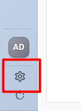

# Whatsapp Basic

## Como Iniciar uma Conexão no WhatsApp

### Passo 1: Acessar Configurações

* Na **tela inicial**, clique no ícone de **Configurações**.
* 

### Passo 2: Entrar em Canais de Atendimento

* Dentro das configurações, selecione **Canais de Atendimento**.

<figure><figcaption></figcaption></figure>

### Passo 3: Criar Nova Conexão

* Clique em **Criar Conexão**.

<figure><figcaption></figcaption></figure>

### Passo 4: Preencher os Detalhes da Conexão

* Um **modal de Nova Conexão** será aberto.
* Insira o **nome da conexão**.
* Selecione um **setor padrão** para essa conexão.

<figure><figcaption></figcaption></figure>

### Passo 5: Avançar e Ler QR Code

* Após preencher os campos, clique em **Avançar**.
* Um **QR Code** será exibido.
* Abra o WhatsApp no celular, vá em **Configurações > Dispositivos Conectados**, e **escaneie o QR Code** para iniciar a conexão.
*
